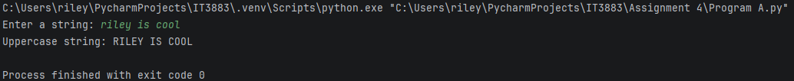

# Assignment 4
# About
### Program Name: Program A and Program B.py
### Course: IT3883/ Section 01
### Student Name: Riley Dunevent
### Due Date: 11/05/2026
### Purpose: What does the program do?:
### Purpose A: Send a string to Program B and display its response.
### Purpose B: Receive a string from Program A, convert it to uppercase, and send the uppercase string back.
### List Specific resources used to complete the assignment.: 
## Class notes and example Client.py and Server.py from d2l and w3 schools.

## Screenshot

